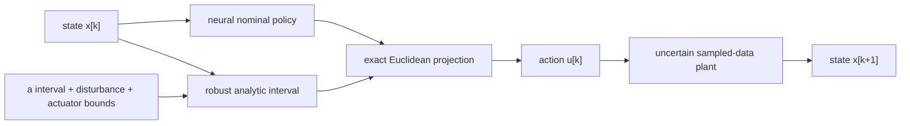
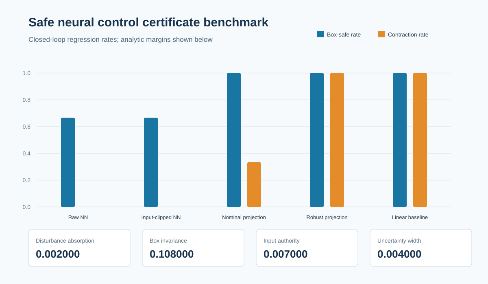

# Safe Neural Control Certificates

[](https://github.com/Aleck-Tao/safe-neural-control-certificates/actions/workflows/ci.yml)
[](https://www.python.org/)
[](LICENSE)

An executable, deliberately small study of an exact certificate layer around a learned controller. A neural nominal policy controls an uncertain unstable scalar sampled-data plant. Its output is either used raw, clipped only to actuator limits, projected using a midpoint model, or projected into an analytically derived robust interval.

The project asks one narrow question: can a controller architecture accept an arbitrary finite neural output while guaranteeing a state box and a practical contraction bound for every declared plant coefficient and bounded disturbance?

> **Claim boundary:** the answer is yes only for the scalar model, parameter interval, disturbance bound, initial set, and exact projection declared here. The neural network alone is not certified. Nothing in this repository establishes physical-system safety, MIMO scalability, continuous-time behavior, actuator validity, or flight safety.

## Closed-loop object

The uncertain plant is

```text
x[k+1] = a*x[k] + b*u[k] + w[k]
a in [1.03, 1.05], b = 0.1, |w[k]| <= 0.01.
```

The open-loop coefficient is greater than one. The declared safe and actuator sets are

```text
|x| <= X = 1.5,       |u| <= U = 2.0.
```

A deterministic one-hidden-layer tanh network is fitted to a smooth synthetic teacher on `[-0.8, 0.8]`. The proposed controller is the composition

```text
u[k] = projection(pi_NN(x[k]), robust_admissible_interval(x[k])).
```

The projection is part of the executed controller path. It is not a post-hoc score assigned to an unchanged policy.



## Analytic guarantee

Let `rho = 0.92`, target tube radius `R = 0.15`, and

```text
eta = (1 - rho)*R = 0.012.
```

For a state inside the safe box, the robust interval contains exactly those actuator-feasible actions that satisfy, for every declared `a`,

```text
|a*x + b*u| <= rho*|x| + eta - disturbance_bound.
```

Projection therefore gives, for every `|w| <= disturbance_bound`,

```text
|x[k+1]| <= rho*|x[k]| + eta.
```

The recurrence implies box forward invariance and

```text
limsup |x[k]| <= eta/(1-rho) = R.
```

The committed certificate records four independently recomputed feasibility margins:

| Obligation | Margin |
|---|---:|
| Disturbance absorption, `eta - d` | 0.002 |
| Box forward invariance | 0.108 |
| Input authority at the worst box/parameter corner | 0.007 |
| Uncertainty-interval width in next-state units | 0.004 |

All are strictly positive. [`docs/derivation.md`](docs/derivation.md) gives the interval construction, non-emptiness argument, and theorem assumptions. [`artifacts/certificate.json`](artifacts/certificate.json) is the machine-readable certificate; `safecontrol verify` recomputes its numbers without calling the generator.

## Five-controller comparison

The benchmark uses 3 scenarios, 6 initial states, and 80 steps per run. The corrupted-policy scenario adds `+3` to the neural output near the positive state boundary.

| Controller | Box-safe runs | Practical-contraction runs | Input-bounded runs | Interpretation |
|---|---:|---:|---:|---|
| Raw NN | 12/18 | 0/18 | 10/18 | No control-facing guard |
| Input-clipped NN | 12/18 | 0/18 | 18/18 | Actuator clipping is not a state certificate |
| Nominal-only projection | 18/18 | 6/18 | 18/18 | Midpoint model omits coefficient uncertainty |
| Robust projection | 18/18 | 18/18 | 18/18 | Satisfies every declared closed-loop regression gate |
| Linear stable baseline | 18/18 | 18/18 | 18/18 | Strong classical baseline; best mean cost in this simple plant |

The linear baseline outperforming the learned controller is retained as a result. This scalar linear plant does not demonstrate a performance need for learning; it isolates the certificate mechanism and shows why a classical baseline must not be omitted.



## Explicit counterexamples

- At `x = 1.45`, `a = 1.05`, outward disturbance, and a `+3` neural-output bias, both the raw and merely input-clipped policies produce `x_next = 1.574173`, outside the `1.5` box. The robust projection produces `x_next = 1.346000`.
- At `x = 1.5`, a projection designed only for `a = 1.04` violates the practical contraction bound by `0.015` when evaluated at `a = 1.05`. The robust projection meets the bound at equality.
- Neural nominal outputs of magnitude `1e12` at both state boundaries remain finite and certified after robust projection.

These negative controls are generated in [`results/counterexamples.json`](results/counterexamples.json) and asserted by tests. They prevent a weak benchmark in which every controller appears successful.

## Reproduce and verify

The only runtime dependency is NumPy.

```bash
python -m venv .venv
python -m pip install -e .
python -m unittest discover -s tests -v
safecontrol verify --root .
safecontrol reproduce --root . --check
```

To regenerate intentionally:

```bash
safecontrol reproduce --root .
safecontrol verify --root .
```

`reproduce --semantic-check` regenerates the scientific values and compares JSON/CSV outputs within a declared `1e-6` absolute and relative tolerance across the six-platform/version CI matrix. `reproduce --check` additionally compares exact bytes in the pinned canonical job (Windows, Python 3.12, NumPy 2.3.5). This split is deliberate: linear-algebra libraries may choose different floating-point reduction orders even when the scientific result is unchanged. `verify` checks source/configuration hashes, synthetic training data, policy and certificate artifacts, result bindings, benchmark gates, exact directory coverage, and the independently recomputed analytic margins.

## Evidence chain

```text
config + package source
        -> deterministic training samples
        -> neural-policy artifact + analytic certificate
        -> closed-loop runs + counterexamples
        -> report + dashboard
```

- [`data/generated/manifest.json`](data/generated/manifest.json) binds package source, configuration, and synthetic training data.
- [`artifacts/manifest.json`](artifacts/manifest.json) binds the neural policy and analytic certificate to that data manifest.
- [`results/result_manifest.json`](results/result_manifest.json) binds six generated result artifacts to both earlier layers.

Hashes detect byte-level inconsistency; they are not signed attestations and do not prove authorship or physical validity.

## Repository map

```text
src/safecontrol/             model, learned policy, projections, simulation, verification, CLI
config/benchmark.json        uncertainty set, bounds, certificate and experiment protocol
data/generated/              deterministic teacher samples and source/data manifest
artifacts/                   learned weights, analytic certificate and artifact manifest
results/                     runs, trace, counterexamples, summary, report and SVG
docs/                        derivation, experiment protocol and limitations
tests/                       analytic corners, extreme outputs, counterexamples and tamper tests
```

## What this contributes - and what it does not

Demonstrated:

- a learned nominal controller composed with an exact robust projection layer;
- a closed-form forward-invariance and practical-contraction certificate;
- coefficient uncertainty and adversarial per-step bounded disturbances;
- classical, weak, nominal, and robust baselines with explicit counterexamples;
- source-to-data-to-certificate-to-result semantic reproducibility across CPU-only CI, plus canonical byte-exact replay.

Not demonstrated:

- an intrinsically stable neural network without a projection layer;
- control barrier/Lyapunov synthesis for a multi-state nonlinear plant;
- quadratic-constraint or semidefinite-program certification;
- measurement noise, delay, quantization, saturation dynamics, or model identification;
- hardware, HIL, flight, or certified safety performance.

The next scientifically meaningful extension is a genuinely multi-state nonlinear motion benchmark with a stabilizing baseline and a numerically verified QC/SDP certificate. It should be a separate, tested result rather than terminology added to this scalar release.

## License

MIT.
